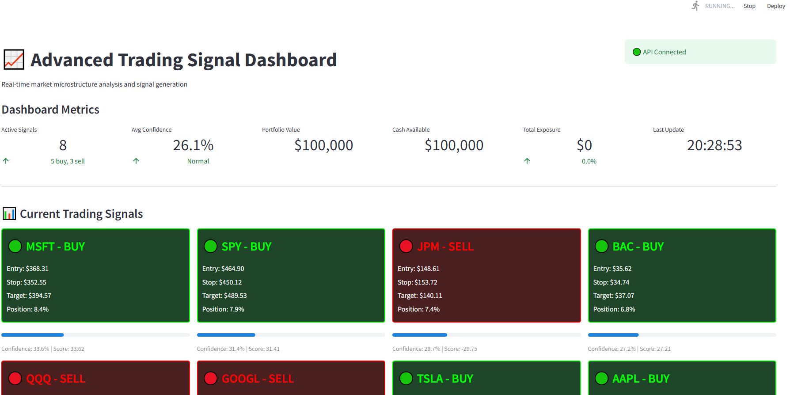
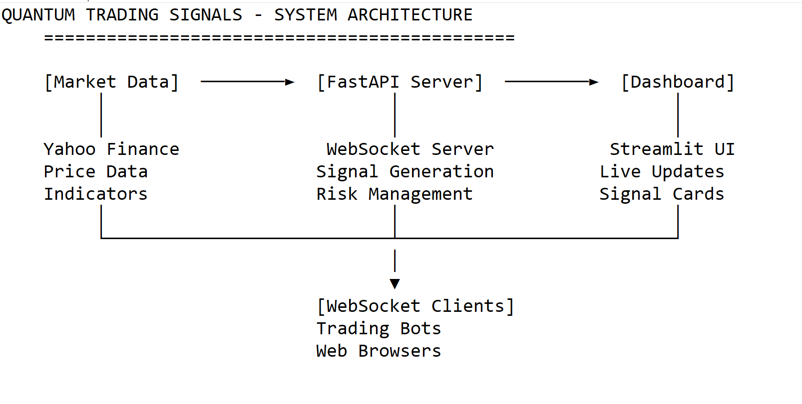

# Quant Trading Signals

A trading signal system that combines technical indicators with market
microstructure analysis. A FastAPI backend generates the signals and streams them
over WebSocket; a Streamlit dashboard displays them.

> **This runs on simulated market data.** It is a demonstration of the
> architecture, not a trading system. Connecting it to a live feed would need real
> data integration, backtesting, risk controls and regulatory compliance first.



## What it does

- Generates signals for eight symbols: SPY, QQQ, AAPL, MSFT, GOOGL, TSLA, JPM, BAC
- Streams live updates over WebSocket
- Sizes positions and sets stop-loss and take-profit levels
- Analyses order flow and liquidity
- Exposes everything through a REST API

## Running it

You need Python 3.11+.

```bash
git clone https://github.com/Boakye-20/quant_trading_signals.git
cd quant_trading_signals

python -m venv venv
source venv/bin/activate          # Windows: venv\Scripts\activate
pip install -r requirements.txt

cp .env.example .env              # optional: API keys for real data sources
```

Start the API:

```bash
uvicorn api.main:app --reload     # http://localhost:8000
```

Then, in a second terminal, the dashboard:

```bash
streamlit run dashboard/app.py    # http://localhost:8501
```

## API

| Endpoint | Method | What it does |
| --- | --- | --- |
| `/` | GET | API information |
| `/health` | GET | Health check |
| `/signals` | GET | All active signals |
| `/signals/{symbol}` | GET | Signal for one symbol |
| `/api/signals` | POST | Generate signals for given symbols |
| `/api/risk` | GET | Portfolio risk metrics |

WebSocket: `ws://localhost:8000/ws`

A signal looks like this:

```json
{
  "symbol": "AAPL",
  "action": "BUY",
  "confidence": 0.72,
  "entry_price": 189.50,
  "stop_loss": 185.25,
  "take_profit": 196.80,
  "position_size": 0.08,
  "timestamp": "2024-01-15T14:30:00Z"
}
```

### Examples

```bash
curl http://localhost:8000/health
curl http://localhost:8000/signals
curl http://localhost:8000/signals/AAPL
```

```python
import requests

signals = requests.get("http://localhost:8000/signals").json()

requests.post(
    "http://localhost:8000/api/signals",
    json={"symbols": ["AAPL", "TSLA"], "lookback_days": 30},
)
```

```python
import asyncio, json, websockets

async def receive_signals():
    async with websockets.connect("ws://localhost:8000/ws") as ws:
        await ws.send(json.dumps({
            "type": "subscribe",
            "symbols": ["AAPL", "MSFT", "GOOGL"],
        }))
        while True:
            print(await ws.recv())

asyncio.run(receive_signals())
```

## How a signal is built

**Technical analysis** — moving averages (20, 50, 200), RSI, Bollinger Bands, volume.

**Market microstructure** — order book imbalance, trade flow toxicity, bid-ask spread.

**Risk management** — Kelly Criterion position sizing, volatility-based stop-loss,
risk-reward optimisation.

These are then combined into one weighted score with a confidence value.



## Project layout

```
api/main.py                     FastAPI app, REST endpoints and WebSocket
dashboard/app.py                Streamlit dashboard
src/
  data_collector.py             Market data (currently simulated)
  signal_generator.py           Signal logic
  microstructure_analyzer.py    Order flow and liquidity
  risk_manager.py               Position sizing and stops
config.py                       Symbols, thresholds, risk limits, API keys
```

Tuning lives in `config.py`: `SYMBOLS`, `LOOKBACK_DAYS`, `SIGNAL_THRESHOLD`,
`MAX_POSITIONS` and `RISK_LIMIT`.

## Roadmap

- Real market data (Alpaca, Polygon)
- Postgres persistence
- Backtesting framework
- ML-based signal optimisation
- Multi-asset support

## Licence

MIT. Author: Paul Kwarteng ([LinkedIn](https://www.linkedin.com/in/paul-kwarteng-22a71b196/)).
